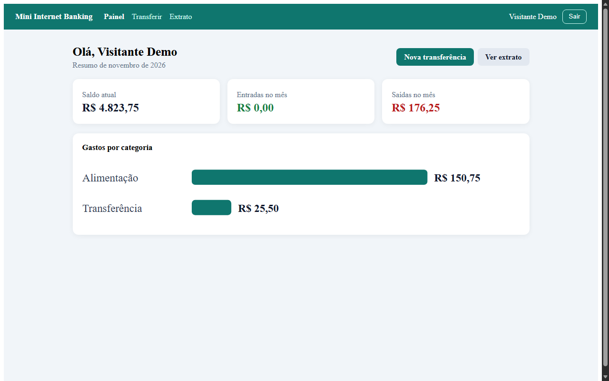
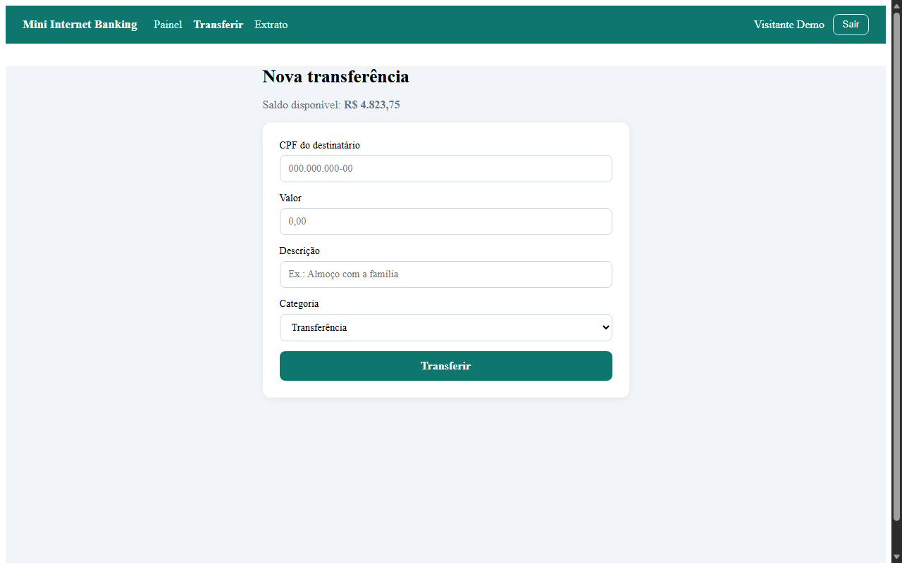
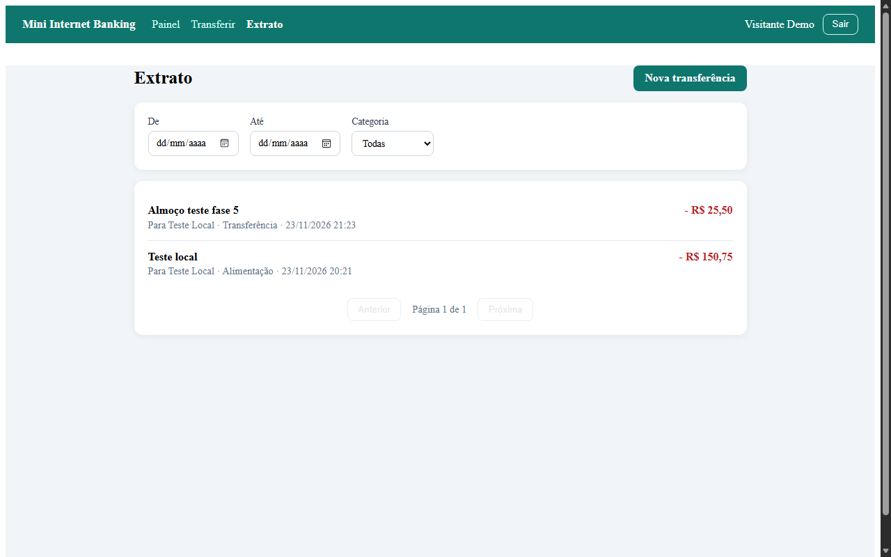
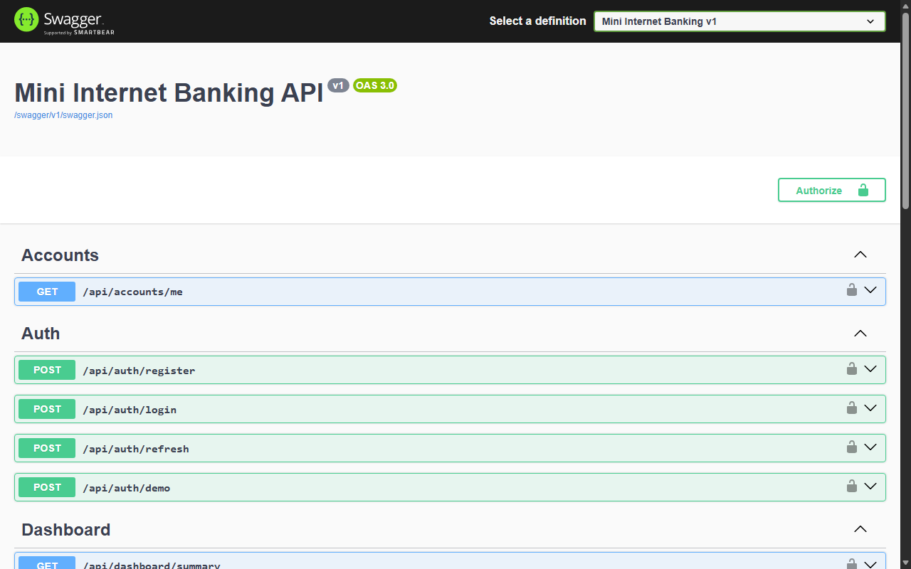

# Mini Internet Banking

Painel de gestão financeira pessoal com transferências entre usuários, extrato filtrado e resumo mensal. Projeto de portfólio, construído com Angular 22 no front-end e .NET 8 + SQL Server no back-end, com tudo containerizado via Docker Compose.

> **Projeto de estudo e portfólio.** Todos os dados são **fictícios**. Não é uma instituição financeira e não movimenta dinheiro real.

## Telas

| Login | Painel |
|---|---|
|  |  |

| Transferência | Extrato |
|---|---|
|  |  |

| Swagger (API) |
|---|
|  |

## Funcionalidades

- **Autenticação:** cadastro, login e acesso como visitante (usuário demo com saldo inicial de R$ 5.000). Sessão com access token JWT e refresh token com rotação.
- **Painel:** saldo atual, entradas e saídas do mês, e gráfico de gastos por categoria.
- **Transferências:** para outro usuário cadastrado, pelo CPF. Valida saldo, CPF e valor, e a operação é atômica (débito, crédito e lançamentos gravados juntos).
- **Extrato:** paginado, com filtro por período e por categoria.
- **Segurança:** guards de rota no front, validação no back-end, erros padronizados em ProblemDetails (RFC 7807).

## Stack

| Camada | Tecnologias |
|---|---|
| Front-end | Angular 22 (standalone components, signals, Reactive Forms, `HttpInterceptorFn`, guards funcionais), Vitest, nginx |
| Back-end | .NET 8 Web API, EF Core 8, FluentValidation, JWT Bearer, Swagger |
| Banco | SQL Server 2022 (migrations automáticas na inicialização) |
| Testes | xUnit + Testcontainers (SQL Server real) no back-end; Vitest + TestBed no front-end |
| Infra | Docker Compose (banco, API e front), Dockerfiles multi-stage, healthcheck e limites de memória |

## Arquitetura

```
01-mini-internet-banking/
├── api/
│   ├── src/
│   │   ├── MiniBanking.Api/              # Controllers, autenticação, tratamento de erros
│   │   ├── MiniBanking.Application/      # Casos de uso (auth, transferências, extrato, dashboard), validadores
│   │   ├── MiniBanking.Domain/           # Entidades (User, Account, Transaction, RefreshToken) e regras
│   │   └── MiniBanking.Infrastructure/   # EF Core, migrations, hash de senha, geração de JWT
│   └── tests/
│       ├── MiniBanking.Application.Tests/  # Testes unitários de domínio
│       └── MiniBanking.Api.Tests/          # Testes de integração (SQL Server em container)
├── web/
│   ├── src/app/
│   │   ├── core/        # Auth, interceptors (Bearer + refresh + erros), guards, toasts, cliente de API
│   │   ├── features/    # Telas: login, cadastro, painel, transferência, extrato
│   │   ├── layout/      # Shell autenticado (cabeçalho e navegação)
│   │   └── shared/      # Componentes e utilitários reutilizáveis (gráfico, máscaras, validadores)
│   └── nginx.conf       # Serve o SPA e faz proxy de /api para a API (mesma origem)
├── docs/screenshots/
└── docker-compose.yml
```

### Decisões técnicas

- **Transferência atômica com concorrência otimista:** o saldo da conta tem `rowversion`. Se duas transferências mexem na mesma conta ao mesmo tempo, a segunda recarrega e tenta de novo (até 10 vezes). Há um teste com 10 transferências simultâneas que confirma que nenhum centavo é perdido e o saldo nunca fica negativo.
- **Valores monetários sempre em `decimal`** (no back-end) e centavos tratados como inteiros na máscara do front.
- **Refresh token com rotação:** cada refresh revoga o token usado. Só o hash SHA-256 é guardado no banco.
- **Renovação de sessão no front:** quando a API responde 401, o interceptor renova a sessão uma única vez, mesmo que várias chamadas falhem ao mesmo tempo, e repete a requisição original.
- **Mesma origem em todo lugar:** em desenvolvimento, o `ng serve` encaminha `/api` para a API; em Docker, o nginx faz o mesmo. Por isso a API não precisa de CORS para o front.
- **Datas em UTC:** a API grava e devolve UTC; o front converte para o horário local.

## Como rodar com Docker (recomendado)

Pré-requisito: Docker Desktop (ou Docker Engine com o plugin Compose).

```powershell
cd 01-mini-internet-banking
copy .env.example .env
```

Edite o `.env` e preencha `MSSQL_SA_PASSWORD` (senha forte do SQL Server) e `JWT_KEY` (pelo menos 32 caracteres). Depois:

```powershell
docker compose up -d --build
```

- Aplicação: http://localhost:4201
- API e Swagger: http://localhost:5088/swagger
- Healthcheck: http://localhost:5088/health

Para entrar rápido, use o botão **"Entrar como Visitante"** na tela de login.

Para parar: `docker compose down` (os dados do banco ficam no volume `dbdata`).

## Desenvolvimento local

Suba só o banco e a API no Docker e rode o front com o servidor de desenvolvimento:

```powershell
docker compose up -d --build db api
cd web
npm install
npm start
```

O front fica em http://localhost:4200 e encaminha `/api` para http://localhost:5088 (ver `web/proxy.conf.json`).

## Testes

```powershell
# Back-end (precisa de Docker: os testes de integração sobem um SQL Server)
cd api
dotnet test

# Front-end
cd web
npm test
```

Estado atual: **11 testes unitários e 23 de integração** no back-end; **46 testes** no front-end.

## Limitações conhecidas

- O token de sessão fica no `localStorage`, o que o deixa exposto a XSS. Em produção real, o ideal seria um cookie `HttpOnly`.
- Não há endpoint de depósito: a única fonte de dinheiro é o usuário demo. Isso limita testes manuais de transferência.
- O gráfico mostra apenas gastos (saídas).
- Não há testes de interface automatizados (E2E); a navegação foi verificada manualmente.

## Status do projeto

- [x] Fase 0: setup (solução .NET, Angular, Docker Compose)
- [x] Fase 1: domínio e autenticação
- [x] Fase 2: contas, transferências e extrato
- [x] Fase 3: resumo do dashboard
- [x] Fase 4: shell do front, login, cadastro e guards
- [x] Fase 5: telas de painel, transferência e extrato
- [x] Fase 6: qualidade (testes, formatação e documentação)
- [x] Fase 7: CI no GitHub Actions (build e testes do back-end e do front, build das imagens)
- [ ] Fase 8: deploy na VPS (Nginx com proxy reverso e SSL)

## Aviso

Projeto educacional. Os dados são fictícios e a aplicação não deve ser usada para dados reais.
